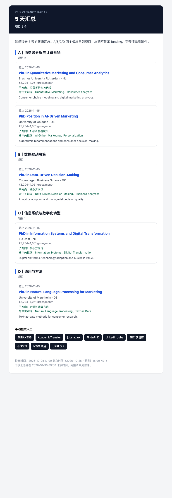

# PhD Vacancy Radar

欧洲带薪博士项目（岗位制）+ funding / PI 雷达。核心逻辑来自你给的 Excel：

> 带薪博士项目的前提是「导师已经有 funding」。所以除了刷招聘网站，还要**反着找**：先盯 ERC / DFG / NWO 等新获 funding 的项目和 PI，再去 PI 的团队主页找项目。

- **有新项目** → 立即发邮件（默认只关注项目，funding 隐藏）；
- **每 5 天** → 发一次汇总（即使没有新增也发，证明监控还活着）；
- 支持 **1–2 个收件邮箱**；
- 邮件和 CSV 都按 **A / B / C / D 四个板块**划分，项目数量不设上限；
- 5 天汇总可带 **CSV / HTML 附件**（完整清单，Excel 直接打开）；
- 跑在 GitHub Actions 云端，不依赖你的电脑和本地网络。



---

## 一、四个板块

关键词库来自《欧洲岗位制PhD_AI追踪关键词库.xlsx》，原始 154 条、去重后 130+ 条，按四个板块组织：

| 板块 | 名称 | 说明 |
| --- | --- | --- |
| **A** | 消费者分析与计算营销 | 定量营销、消费者分析、计算营销、平台/社交媒体、AI 与消费者决策 |
| **B** | 数据驱动决策 | 数据驱动决策、决策分析、analytics adoption、算法辅助决策 |
| **C** | 信息系统与数字化转型 | 信息系统、数字创新、技术采纳、平台与组织 |
| **D** | 通用与方法 | 文本挖掘、NLP、因果推断、选择模型、需求估计，以及泛商科（management / business / analytics 等）作为兜底 |

### 分类是怎么定的

- 每个板块下面按 Excel 的「子方向 / 关键词类别」拆成若干子方向，例如 A 有「消费者行为与选择」「AI 与消费者决策」「平台与社交媒体」等；
- 关键词带权重：核心方向词 3.0、子方向词 2.5、方法词 2.0、板块锚点 2.0；
- **标题命中 ×2，正文/摘要命中 ×1**；加权分最高的板块就是归类结果，同时把命中的子方向一起记下来（邮件/CSV 里的「子方向」）；
- 「Marketing」「Management」「Digital」这类锚点词，专门处理 `PhD in Marketing` 这种宽标题；
- funding 不参与四个板块，只作为最后的支撑线索。

> 邮件和 CSV **不显示匹配分**。分数只在程序内部用于排序和决定“要不要立即发信”；你看到的是板块、子方向、命中关键词和原始链接。

---

## 二、它监控什么

### 自动监控（默认开启）

| 源 | 地区 | 抓什么 | 方式 |
| --- | --- | --- | --- |
| **jobs.ac.uk** | 英国 | PhD / doctoral / studentship 项目 | 搜索页 HTML |
| **AcademicTransfer** | 荷兰 | 带薪博士项目（含薪资、截止日期） | sitemap + 详情页 JSON-LD |
| **University of Copenhagen** | 丹麦 | PhD / doctoral 项目 | 招聘页 HTML |
| **University of Amsterdam** | 荷兰 | PhD 项目（按 PhD 过滤） | 招聘页 HTML |
| **Copenhagen Business School** | 丹麦 | PhD / scholarship 项目 | 招聘页 HTML |
| **University of Groningen** | 荷兰 | PhD / promovendus 项目 | 招聘页 HTML |
| **Vrije Universiteit Amsterdam** | 荷兰 | PhD / promovendus 项目 | 招聘页 HTML |
| **GEPRIS (DFG)** | 德国 | 在研项目、PI、机构（默认隐藏） | 前端检索接口 |
| **NWO** | 荷兰 | 已获 funding 的项目、PI（默认隐藏） | 官方 NWOpen API |
| **UKRI GtR** | 英国 | 已获 funding 的项目（默认隐藏） | 官方 API |

搜索词已经按新关键词库更新：定量营销、消费者分析、AI 营销、数据驱动决策、商业分析、信息系统、数字化转型等。

> `show_funding = false`（默认）时，GEPRIS / NWO / UKRI 这三个 funding 源**不抓取、不进邮件、不进 CSV**，只跑项目源。想让它们作为「支撑线索」出现，把 `show_funding` 改成 `true`。

### 手动入口（邮件底部常驻）

EURAXESS、FindAPhD、Academic Positions、LinkedIn Jobs、ERC 项目库、DFF、Research Portal Denmark、各大学招聘页。

> 这些站点要么有 Cloudflare / 登录 / 地区限制，要么没有稳定 API；工具会把它们作为「手动检索入口」放在每封邮件底部。

### 排序与阈值（内部逻辑，不在邮件显示）

- 标题必须命中 A/B/C/D 任一板块的关键词，否则直接丢弃；
- 命中关键词越多、方法越匹配、国家越优先、越新、越有薪资/合同信息，内部排序越靠前；
- 自费 / 收学费 / 领域明显偏离（法律、医学、生物、物理、工程等）会被剔除；
- 项目内部排序分 ≥ **5.0** 时立即发邮件，其余进 5 天汇总；项目数量不设上限，全部列出（前 8 条详细卡片，其余紧凑列表）。
- funding 默认不参与；`show_funding=true` 时才会抓取并作为最后的支撑线索出现。

首次运行只建立基线，不会把历史积压一次性当「新项目」轰炸你。

---

## 三、邮件长什么样

按四个板块组织，**每个板块只列项目（学校/招聘页直招），数量不设上限**；默认不显示 funding。每条项目会标出「子方向」和「命中关键词」，不显示匹配分。

即时告警**只发项目**；funding 只进 5 天汇总，避免被 PI 项目淹没。

```
【A｜消费者分析与计算营销】项目 2 · funding 1

- PhD in Quantitative Marketing and Consumer Analytics
  Erasmus University Rotterdam · NL · 截止 2026-11-15
  薪资/经费：€3,204–4,051 gross/month
  命中关键词：Quantitative Marketing、Consumer Analytics
  链接：...
```

邮件的 5 天汇总会带附件（默认 CSV，可改 `html` / `both`）：

- `phd-radar-YYYY-MM-DD.csv`：列 = 板块、类型、标题、机构、国家、城市、PI、来源/计划、截止日期、发布日期、薪资/经费、命中关键词、链接、摘要；UTF-8 BOM，Excel 不乱码；
- `phd-radar-YYYY-MM-DD.html`：按四个板块分组的完整表格，链接可点击。

---

## 四、部署（10 分钟）

1. 新建 GitHub 仓库（建议 **Public**），把本项目上传；
2. **Settings → Actions → General**：允许 Actions，Workflow permissions 选 **Read and write**；
3. **Settings → Secrets and variables → Actions → Secrets** 添加：
   - `MAIL_TO`：1–2 个邮箱，英文逗号分隔
   - `MAIL_USERNAME`：发件邮箱
   - `MAIL_PASSWORD`：SMTP 授权码
4. Actions → Run workflow → `test-email`，确认两个邮箱都能收；
5. 再跑 `check`，收到「监控已启动」+ 基线附件。

之后每小时检查一次；有新项目立即发信，每 5 天汇总。

---

## 五、暂停 / 恢复 / 重置状态

| 模式 | 作用 |
| --- | --- |
| `stop` | 软暂停：之后每小时仍会启动 workflow，但不抓取、不发信 |
| `resume` | 恢复监控 |
| `reset` | 清空 `state.json`，下一次 `check` 重新建立基线并发送「监控已启动」 |

`stop` 只是软暂停；想彻底停止运行，去 **Actions 右上角 ⋯ → Disable workflow**。

---

## 六、配置

| 配置 | 默认 | 说明 |
| --- | --- | --- |
| `[[section]]` | A/B/C/D | 板块名称、锚点词；`[[section.sub]]` 是子方向和带权重的关键词 |
| `monitor.alert_score` | 5.0 | 新项目立即告警阈值（内部） |
| `monitor.award_alert_score` | 8.0 | 新 funding 立即告警阈值（内部） |
| `monitor.digest_every_days` | 5 | 汇总间隔 |
| `monitor.digest_detail_items` | 8 | 每个板块前几条用详细卡片 |
| `monitor.digest_attachment` | csv | 汇总附件：csv / html / both / none |
| `monitor.show_funding` | false | 是否抓取并显示 funding 支撑线索 |
| `monitor.funding_display_limit` | 10 | 显示 funding 时，邮件里最多列几条 |
| `monitor.max_items_per_email` | 0 | 0 = 不限制项目数量 |
| `profile.country_bonus` | NL/DK 3… | 国家偏好 |

想加大学招聘页：复制 `uni_page` 那段，填 `url`、`institution`、`country`、`href_contains` 即可。

---

## 七、本地运行

```bash
python3 -m venv .venv && source .venv/bin/activate
pip install -r requirements.txt
MAIL_PROVIDER=none python -m phd_radar check --dry-run
python -m unittest discover -s tests -v
```

---

## 八、已知限制

- **EURAXESS / FindAPhD / Academic Positions / LinkedIn** 有 Cloudflare、登录或地区限制，未做自动抓取；邮件底部保留入口。
- **GEPRIS** 用的是网页前端检索接口，不是正式公开 API；已限速并只取在研项目，如遇改版需调整。
- **AcademicTransfer** 只抓最新 + 营销/商科相关 slug 的岗位（每次约 30 个详情页），不是全量；它同时覆盖 Tilburg、Erasmus、RUG、VU 等荷兰高校。
- 已直接接入 5 所学校的招聘页（UvA、CBS、RUG、VU、UCPH）；Tilburg / Erasmus / Aarhus 的招聘列表是 JS 渲染或改版 404，暂未接入，避免制造假的“源失败”。
- 项目数量不设上限，邮件可能较长；完整清单始终在 CSV 附件里。
- 关键词是规则匹配，不是语义模型；同义表达可能漏，泛词可能误命中。邮件里的「命中关键词」就是给你快速判断用的。
- 云端 IP 仍可能被个别站点临时封禁；连续失败会在状态表里标红。

---

## 九、数据来源

- 招聘：jobs.ac.uk、AcademicTransfer、University of Copenhagen
- 资助：DFG GEPRIS、NWO NWOpen API、UKRI Gateway to Research
- 关键词：`欧洲岗位制PhD_AI追踪关键词库.xlsx`（A/B/C/D 四板块）

*非官方工具；请遵守各网站的使用条款。*
